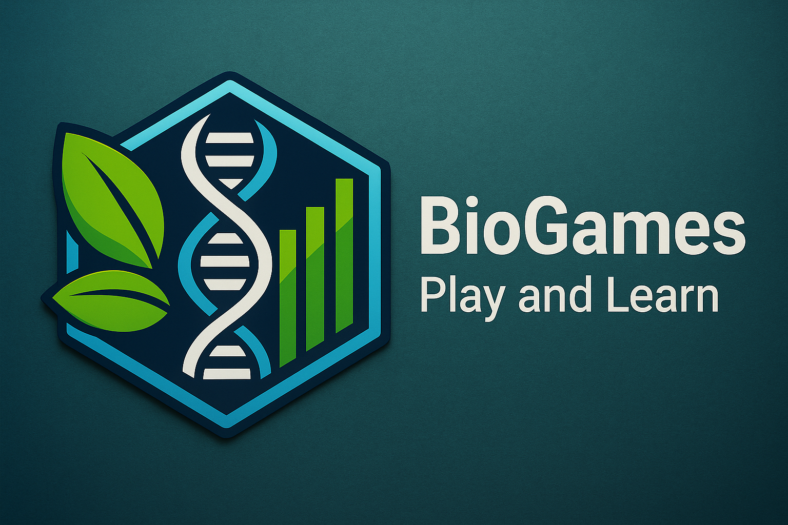

# BioGames | Play and Learn

**BioGames** is a collection of interactive, biology-themed web games built with **React** and **Next.js**. It is designed as an educational and entertaining platform to explore key biological concepts through gameplay.

[Play it now!](https://bio-games.vercel.app/)

> This repository is a continuation of [DEPRECATED-biogames](https://github.com/manumei/DEPRECATED-biogames-)

---

## 🎮 Released Games

### **Taxo Bingo** (`/taxo-bingo`)

*Match organisms to the 12 taxonomic categories on the bingo grid. Fill all 12 cells to win!*

---

## 🔜 Coming Soon

Defined in [`games/registry.ts`](games/registry.ts) and specified in `tasks/`:

- **Bio Wordle** (`bio-wordle`)
- **Symptoms Link** (`symptoms-link`)
- **Animal Tic-Tac-Toe** (`animal-tictactoe`)
- **Bio Top 8** (`bio-top8`)
- **Cell Classifier** (`cell-classifier`)

---

## 🛠️ Development

```bash
npm install        # Install dependencies
npm run dev        # Start local dev server (http://localhost:3000)
npm run check      # Run lint + typecheck + unit/data tests
npm run build      # Create production build
```

To rebuild the Taxo Bingo WebP images and `data/organisms.json` from `raw-assets/taxo/`:

```bash
python scripts/build_taxo_dataset.py
```

---

## 🗂️ Project Structure

- `app/` — Thin Next.js App Router pages, metadata, manifest, and global theme tokens
- `components/` — Shared layout (`Header`, `Footer`), home (`GameCard`), UI kit (`components/ui/`), and game shells (`components/game/`)
- `games/` — `registry.ts` and self-contained game modules (`games/taxo-bingo/`)
- `data/` — Typed taxonomy catalog (`taxonomy.ts`) and generated organism dataset (`organisms.json`, `organisms.ts`)
- `lib/` — Pure platform utilities (`rng`, `daily`, `storage`, `stats`) and hooks
- `scripts/` — Python asset & dataset pipeline (`build_taxo_dataset.py`, `square_cover.py`)

See [**`docs/ARCHITECTURE.md`**](docs/ARCHITECTURE.md) for the full architecture and API reference.

---

## ⚙️ Tech Stack

- **Framework:** Next.js 16 (App Router, React 19)
- **Language:** TypeScript 5
- **Styling:** Tailwind CSS 4
- **Testing:** Vitest
- **Hosting:** Vercel

---

#### Created by Manuel Meiriño
